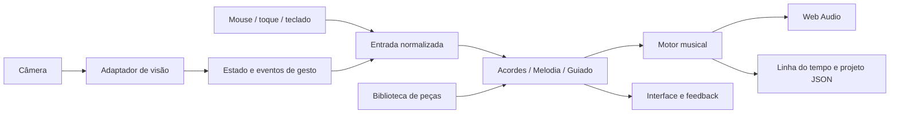

# Arquitetura proposta: Melodycam

**Status:** arquitetura do protótipo; revisar após medir desempenho.

## Escolha de plataforma

Aplicação **web client-side**, escrita em **TypeScript** com **React + Vite**. As regras de gestos ficam em `src/gestures.ts`, e o motor de áudio e os dados musicais ficam em `src/music.ts`, sem dependência de React. A orquestração atual está em `src/main.tsx`. Não há backend no MVP. Dados do projeto podem ser baixados e abertos como arquivos JSON. A aplicação pode ser hospedada como site estático em HTTPS.

Essa escolha reduz instalação para quem só quer experimentar, facilita contribuição e permite que a imagem da câmera fique no dispositivo. A câmera via `getUserMedia()` depende de permissão e contexto seguro; o áudio precisa ser iniciado por uma ação da pessoa por causa das políticas de reprodução automática dos navegadores ([MDN: getUserMedia](https://developer.mozilla.org/en-US/docs/Web/API/MediaDevices/getUserMedia), [MDN: práticas de Web Audio](https://developer.mozilla.org/en-US/docs/Web/API/Web_Audio_API/Best_practices)).

## Fluxo de dados



## Módulos e contratos

| Módulo | Responsabilidade | Contrato esperado |
| --- | --- | --- |
| `vision` | Lê vídeo e fornece pontos de até duas mãos | `HandFrame { timestamp, hands: [{ landmarks, confidence, handedness }] }` |
| `gestures` | Filtra ruído, calibra e emite transições por mão | `SelectionChanged`, `ExecuteStart`, `ExecuteEnd`, `TrackingLost` |
| `input` | Traduz gesto, mouse, toque e teclado para ações comuns | `SelectChord`, `SelectPitch`, `SoundStart`, `SoundEnd` |
| `music` | Acordes, escalas, sequenciamento e duração | Eventos musicais sem dependência da câmera |
| `audio` | Síntese e agendamento | `playChord(pitches, time)`, `noteOn(pitch, time)`, `stop(id, time)`, `stopAll()` |
| `library` | Carrega e valida peças | Manifesto e esquema versionados |
| `project` | Salva e abre JSON | Validação, migração de versão e erros úteis |
| `ui` | Tutorial, feedback, controles e acessibilidade | Estado derivado dos módulos, sem regras musicais embutidas |

**Regra importante:** timestamps de câmera e relógio de áudio são domínios diferentes. O adaptador de áudio recebe ações e agenda som em `AudioContext.currentTime`; não usar o tempo de renderização do React para determinar a duração das notas. Para síntese simples, começar com nós nativos da Web Audio API; avaliar `AudioWorklet` apenas se medições mostrarem necessidade de processamento customizado em tempo real ([MDN: AudioWorklet](https://developer.mozilla.org/en-US/docs/Web/API/AudioWorklet)).

## Dependências candidatas

- **MediaPipe Hand Landmarker (`@mediapipe/tasks-vision`)** para pontos de até duas mãos em vídeo. A implementação web oferece landmarks, lado da mão e detecção em modo vídeo; a classificação de poses, gesto de execução e filtro de ruído são lógica do projeto ([documentação oficial](https://developers.google.com/edge/mediapipe/solutions/vision/hand_landmarker), [configuração web](https://developers.google.com/edge/mediapipe/solutions/setup_web)). Fixar versões e hospedar os arquivos de modelo/WASM junto da aplicação depois de conferir suas condições de distribuição.
- **Tonal** como candidata para escalas e nomes de notas; não produz som ([repositório oficial](https://github.com/tonaljs/tonal/blob/main/README.md)). Usar somente o necessário após avaliar o tamanho do pacote.
- **Web Audio API** para síntese com osciladores, filtro passa baixas, delay, reverberação por convolução e analisador para o osciloscópio. Os presets são parâmetros locais e não exigem samples.

Não escolher biblioteca de estado global, framework de backend ou banco de dados antes de um caso de uso demonstrar necessidade. Um esquema JSON pequeno e versionado basta para o MVP.

## Formato inicial de dados

```json
{
  "schemaVersion": 1,
  "title": "Minha progressão",
  "mode": "chords",
  "tempoBpm": 100,
  "scale": { "tonic": "C", "type": "major-pentatonic" },
  "events": [
    { "type": "chord", "symbol": "Am", "pitchesMidi": [57, 60, 64], "startBeat": 0, "durationBeats": 1, "velocity": 0.8 }
  ]
}
```

Eventos de melodia do protótipo usam `type: "note"`, um único valor em `pitchesMidi` e `mode: "performance"`. A escolha conserva o formato de evento da versão 1. Uma peça da biblioteca deverá acrescentar `author`, `source`, `license`, `licenseUrl` e `suggestedTempoBpm`. Separar a **sequência original** da **performance gravada** impede que interpretações sobrescrevam o material de origem. Validar limites de campos na importação e rejeitar arquivos incompatíveis com mensagem legível.

## Qualidade e privacidade

- Iniciar vídeo somente após consentimento do navegador; parar todas as trilhas ao desligar a câmera ou sair da performance.
- Não registrar imagens, landmarks ou identificadores do dispositivo em telemetria padrão.
- Não solicitar microfone no MVP.
- Liberar notas ativas em `visibilitychange`, interrupção da câmera e erro de rastreamento.
- Verificar licenças separadamente para código, modelo, peças musicais, fontes, ícones e quaisquer samples. Uma licença de código não cobre automaticamente músicas.
- Testar comportamento musical puro com eventos simulados, sem câmera. Usar testes de integração para o ciclo câmera → gesto → som e sessões reais para latência e usabilidade.

## Alternativa futura

Se a latência ou as permissões do navegador atrapalharem o uso, a divisão entre módulos permite empacotar a interface como aplicação desktop sem reescrever regras musicais. Essa decisão depende dos resultados da prova técnica.
